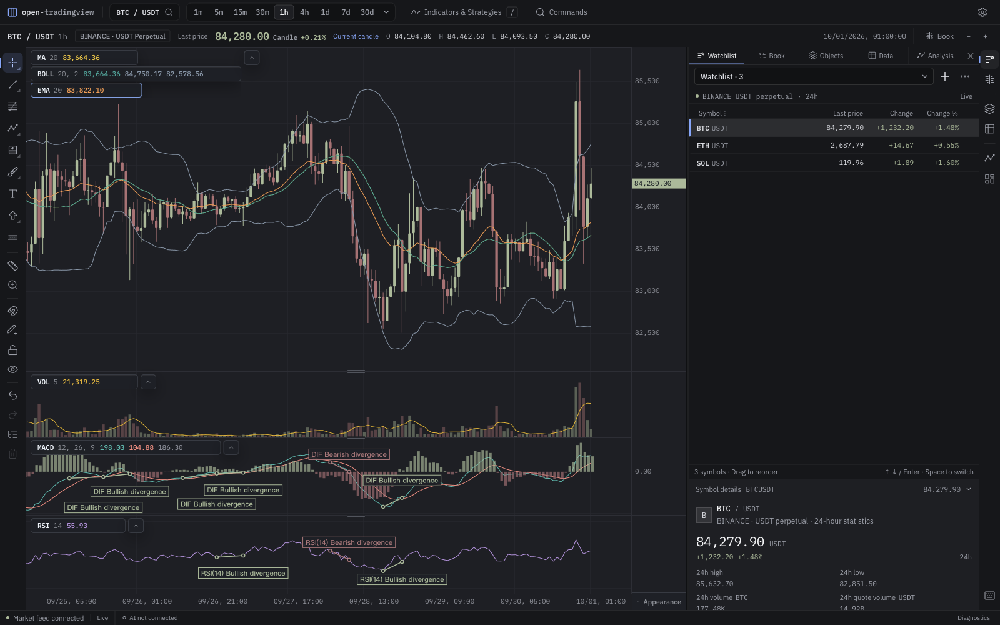
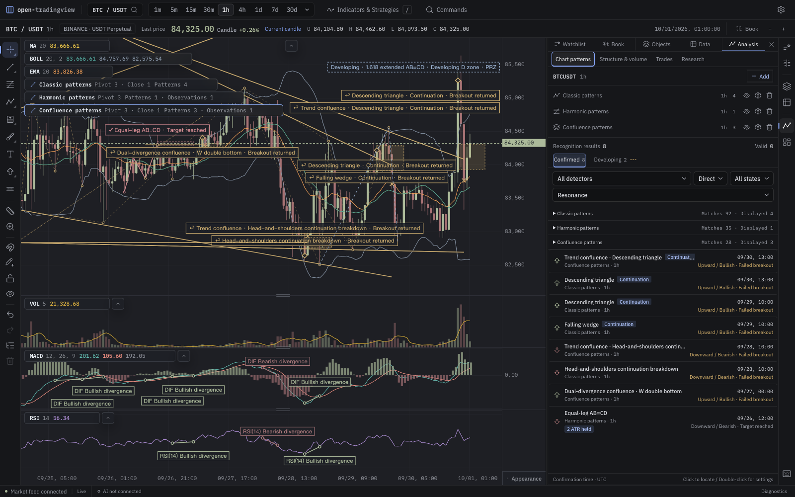
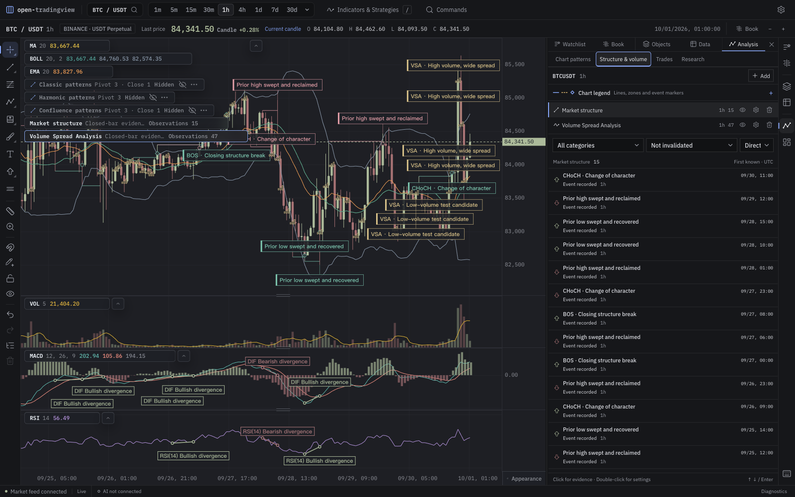
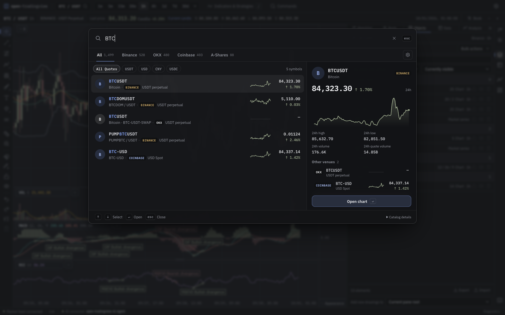
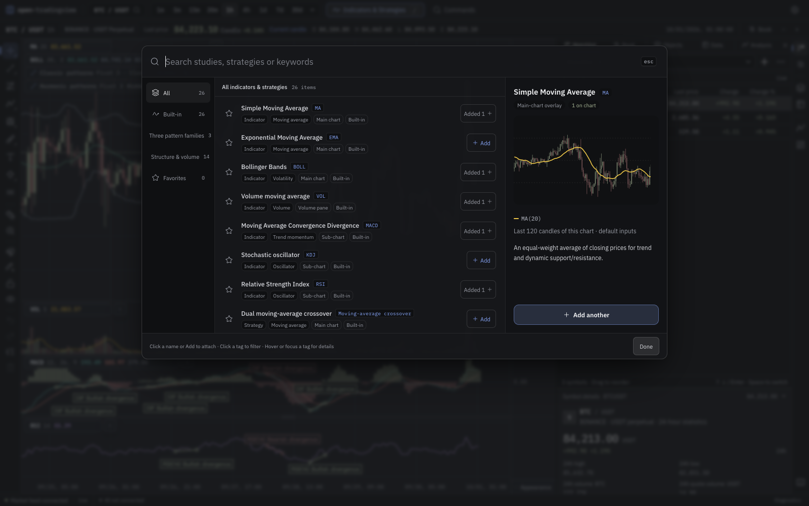
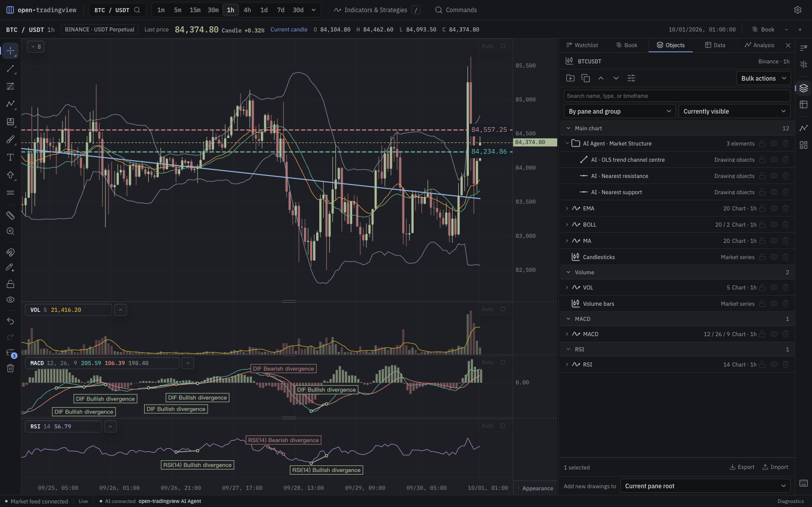

# open-tradingview

### 流畅看盘，清晰观察市场结构，让自己的 AI Agent 参与分析。

一个面向加密货币的本地图表与技术分析工作台。自研 WebGL 渲染连接实时 K 线、三类形态、技术指标、结构量价与 AI Agent。

**可免费本地运行 · 公开行情无需 API Key · 中文 / English**

早期预览 · MIT 许可 · 持续公开开发

[English](README.md) · [快速开始](#快速开始) · [三类形态](#三类形态同图观察) · [AI Agent](#让自己的-ai-agent-理解和标注图表) · [开发指南](docs/developer-guide.md)



*截图来自 2026 年 10 月 1 日实际运行的应用。行情场景使用 Binance 公开数据；另行标注的百万根场景使用模拟数据。*

## 从图表出发

- **操作跟上分析节奏。** 平移、缩放、读取 K 线、调整指标窗格，在自研 WebGL2 / Canvas 图表内完成。
- **三类形态相互参照。** 经典价格结构、谐波比例与量价共振，结合图表和证据工作区观察。
- **配置你的指标视角。** MA、EMA、布林带、成交量、MACD、KDJ、RSI 可重复添加，分别配置参数、样式及当前或更高计算周期。
- **把走势放回结构与量价中。** 查看 BOS/CHoCH、扫高低点、供需区域、FVG、Order Block、VSA、威科夫等原生模块。
- **找到商品，再组织分析。** 按代码、名称或交易对搜索，从统一弹框添加指标、信号策略、形态和分析模块。
- **接入自己的 AI Agent。** 读取结构化行情，测量市场结构，按时间和价格添加可编辑标注，并支持撤销。

## 快速开始

需要 **Node.js 24+** 和 **pnpm 10.33.0**：

```sh
git clone https://github.com/Timelk/open-tradingview.git
cd open-tradingview
pnpm install --frozen-lockfile
pnpm dev --host 127.0.0.1
```

打开终端显示的地址，通常是 `http://127.0.0.1:5173`。全新工作区默认进入 **Binance BTCUSDT 永续、15 分钟周期**。公开行情无需交易所账号或 API Key。

1. 从工具栏搜索商品或交易对。
2. 打开 **指标与策略**，添加 RSI 或布林带。
3. 选择 **三类形态**，或进入 **分析 → 图表形态**。
4. 进入 **分析 → 结构与量价**，添加原生分析模块。
5. 需要 AI 协作时，连接自己的客户端读取或标注图表。

本地 Node 服务提供公开行情传输、SQLite 档案与 MCP。纯 `dist/` 静态部署不包含这些本地服务。[运行方式与存储](docs/developer-guide.md#running-the-project)。

## 围绕交互打造的渲染内核

图表内核直接管理数据与绘制：TypedArray 列存、多级 OHLCV 聚合、Worker 增量指标计算、WebGL2 绘制与 Canvas 降级。界面接收读数和状态，避免为每根 K 线创建组件。

价格、成交量与振荡指标共用时间轴，并保留独立纵轴。调整窗格、最大化主图、磁吸十字光标、手工绘图和组织对象，都在同一工作区进行。

[百万根模拟数据场景](docs/assets/screenshots/native-2026-10-01/million-candles-simulation.png) · [当前验证与性能口径](docs/native-scope-validation-2026-10-01.md)

百万模拟数据连续缩放本机实测约 **60 FPS**，整帧 P95 约 **4.3 ms**：Apple M5、1600×1000 / DPR1、五个指标。密集历史背离按像素密度绘制，完整证据档案保留。表现随设备、视口、范围和模块变化。[实测记录](docs/assets/screenshots/native-2026-10-01/render-performance.json)。

## 三类形态，同图观察

| 形态体系 | 当前能力 |
| --- | --- |
| **经典形态** | 三角形、楔形、头肩、双顶底、通道、旗形及其他价格结构 |
| **谐波形态** | AB=CD 与其他斐波那契比例家族、完成区域与发展中的候选 |
| **量价共振** | 顺势突破与双背离反转，结合量能及初始盈亏比条件 |



区分候选、确认、突破、回踩和失效。单击结果定位证据，调整识别器参数，或将观察转成可继续编辑的手绘。每项结果都依赖明确规则和已加载的数据覆盖。

[查看三类形态弹框](docs/assets/screenshots/native-2026-10-01/three-pattern-families.png)。

## 指标、结构与量价，一起看

均线提供趋势视角，结构突破、扫高低点与成交量事件提供背景。原生分析模块将这些观察放回价格图表，并保留首次可知时间、锚点与依据。



当前库包含 **7 个经典指标、2 个原生信号策略、3 类形态与 14 个结构量价模块**。指标可多次添加、独立配置；当前每个场景上限为 64 个指标实例。

信号策略用于标注均线交叉、RSI 阈值等条件。自研策略与回测引擎属于后续路线图。

## 搜索商品，组织分析视图

按代码、名称或交易对搜索，按来源和计价币筛选，预览行情并加入自选。Binance 永续是当前最完整路径；OKX 永续与 Coinbase 现货连接器的具体能力各有差异。



**指标与策略** 弹框统一提供搜索、收藏、模块分类、默认参数与真实指标预览。形态及结构量价模块添加后在实际图表中展示。



[查看结构量价模块目录](docs/assets/screenshots/native-2026-10-01/structure-library.png)。

## 让自己的 AI Agent 理解和标注图表

本机 MCP 桥接向 Agent 提供 K 线、指标结果、形态、市场结构、绘图和可见布局。Agent 可以测量价位，按准确的时间和价格绘图，添加原生指标或叠加层，并沿用界面的场景操作。



*图中的标注由真实 MCP 客户端依据当前图表的结构结果创建。支撑阻力和拟合趋势为测量结果，截图不表示交易执行。*

- 通过 21 个 MCP 工具读取与分析当前图表。
- 在对象树中分组、编辑 AI 标注。
- 撤销写入，或通过状态栏关闭图表修改权限。
- 使用自己的 AI 客户端；应用没有内置托管模型账号。

以 Claude Code 为例，端口按实际应用地址替换：

```sh
claude mcp add --transport http open-tradingview http://127.0.0.1:5173/mcp
```

访问运行中应用的 `/llms.txt` 查看接入指南。[AI 连接状态截图](docs/assets/screenshots/native-2026-10-01/ai-agent-connection.png) · [MCP 架构](docs/architecture/agent-bridge.md)。

## 更多原生工具

已有绘图、磁吸、撤销重做、图层分组、命名布局、自选、逐柱分析回放和本地成交 / 深度档案。Binance USDT 永续订单流包含盘口、Delta/CVD、Footprint、Profile 和已采集的深度热图，明确显示覆盖与缺口。[行情存储](docs/market-data-storage.md)。

## 路线图

- [x] 原生图表内核、指标窗格与可配置工作区。
- [x] 经典、谐波、量价共振形态，以及结构量价分析。
- [x] 商品搜索、指标库、绘图与本机 AI Agent 桥接。
- [ ] 优化密集历史证据和大数据范围下的交互渲染。
- [ ] 从双图开始，实现品种、周期与十字光标联动。
- [ ] 后续独立设计并自研策略计算与回测引擎。
- [ ] 补齐更多连接器、分析回放与研究数据集分享。
- [x] 以 MIT 许可发布首版源码预览，并完成全新源码验证。

当前是一张价格主图配多个指标窗格和停靠面板。PineTS、Pine 编辑与策略回测已从当前预览移除。

## 开发与参与

```sh
pnpm check
pnpm test
pnpm build
```

欢迎可复现的交互问题、渲染基准、指标定义、行情连接器、翻译，以及最小数据 / 证据案例。反馈请附数据源、商品、周期和操作步骤。

[开发指南](docs/developer-guide.md) · [绘图扩展](docs/architecture/drawing-tools.md) · [图层工作区](docs/architecture/layer-workspace.md)

## 许可证

项目采用 [MIT 许可](LICENSE)。第三方依赖保留各自许可与原始声明，见 [THIRD_PARTY_NOTICES.md](THIRD_PARTY_NOTICES.md)。PineTS 与 Monaco 已不再属于运行依赖。

open-tradingview 为独立项目，与 TradingView 或任何交易所没有隶属关系。商标归其各自权利人所有。
