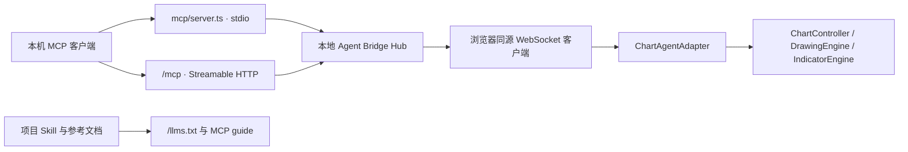

# AI 图表桥接：原生分析、绘图与 MCP

本机 AI 客户端可以读取用户当前图表的 K 线、指标、绘图、形态与结构量价结果，再用已注册绘图工具或通用叠加层标注。原生绘图和指标改动使用界面相同的校验、场景事务与撤销路径；保存的绘图仍可由用户编辑。

本文描述当前原生图表版本。发布准备与验收范围见 [原生范围验证](../native-scope-validation-2026-10-01.md)。运行中的 `/llms.txt`、别名 `/llm.txt` 与完整版 `/llms-full.txt` 提供实时连接状态、接入方式、工具清单和项目使用指南。

## 能力与范围

| 能力 | 当前工具与行为 |
| --- | --- |
| 当前图表 | `list_charts`、`get_chart_state`：市场、十字光标、视窗、窗格、选中对象、图层、绘图、指标、叠加层和原生分析状态 |
| 数据 | `get_bars`、`get_indicator_data`：已加载 OHLCV 与指标/叠加序列，按上限采样或聚合并说明规则 |
| 形态与分析 | `get_analysis`：已挂载模块的经典、谐波、共振形态及结构量价观察；保留候选、确认和证据状态 |
| 精确结构 | `get_structure`：摆动点、HH/HL/LH/LL、ATR、价位聚类与最小二乘趋势通道，在浏览器数据上计算 |
| 画面理解 | `describe_chart`、`capture_chart`、`locate`：真实图元布局报告、字符画、画布截图与像素/时间/价格转换 |
| 原生绘图 | `get_catalog`、`draw`、`update_objects`、`delete_objects`：查询工具契约，创建或修改可保存、可撤销的绘图与对象 |
| 指标实例 | `add_indicator`、`update_indicator`：使用实际注册的指标、形态及分析定义；修改输入、计算周期、样式与可见性 |
| 通用叠加 | `set_overlay`、`remove_overlays`：会话内曲线、柱、带状、信号、形状及标签/框/线对象，可使用独立窗格 |
| 视图与交互 | `set_view`、`select_objects`、`undo_redo`、`wait_for_event`：切换公开市场或视窗、选择对象、撤销/重做与等待图表事件 |

这些工具操作当前浏览器图表，不提供账户查询、真实下单或跨机器远程服务。内置信号模块只展示信号。工具的准确参数来自 MCP `tools/list` 或运行中的 `/llms-full.txt`，不要根据名称推断未声明能力。

## 接入方式

需要 Node.js 24+，先在仓库根目录启动本地应用并打开图表：

```sh
pnpm install --frozen-lockfile
pnpm dev --host 127.0.0.1
```

HTTP 客户端连接同一地址的 `/mcp`。以下示例使用默认开发端口；端口以终端输出为准：

```sh
claude mcp add --transport http open-tradingview http://127.0.0.1:5173/mcp
```

stdio 客户端启动仓库中的 MCP 进程，它会发现本项目正在运行的本地服务。bash/zsh 可在仓库根目录使用：

```sh
claude mcp add open-tradingview -- node "$PWD/mcp/server.ts"
```

其他环境可将脚本参数改为加引号的本地绝对路径。已有项目配置见 [.mcp.json](../../.mcp.json)；客户端启动 stdio 进程时需要能找到 Node。HTTP 服务端口改变后应更新 URL，stdio 则通过 `.data/agent-bridge/hubs/` 发现记录查找服务。

## 架构与实现入口



| 组件 | 文件 | 职责 |
| --- | --- | --- |
| 协议 | [protocol.ts](../../src/lib/agent/protocol.ts) | 方法、读写分类、会话、事件、进度、超时与活动图表判定 |
| 锚点与采样 | [anchors.ts](../../src/lib/agent/anchors.ts)、[sampling.ts](../../src/lib/agent/sampling.ts) | 时间/价格/柱位置与 OHLCV、序列分桶 |
| 结构计算 | [structure.ts](../../src/lib/agent/structure.ts) | 摆动点、ATR、价位聚类与趋势通道 |
| 状态与布局 | [snapshot.ts](../../src/lib/agent/snapshot.ts)、[layout.ts](../../src/lib/agent/layout.ts) | 原生图表状态与真实渲染几何、裁切/遮挡检查、字符画 |
| 通用叠加 | [overlays.ts](../../src/lib/agent/overlays.ts) | 时间空间定义转换为图表 `OverlayPlot`，随已加载 K 线重新对齐 |
| 适配器 | [chart-adapter.ts](../../src/lib/agent/chart-adapter.ts)、[target.ts](../../src/lib/agent/target.ts) | 校验、事务、锁/忙/写权限、方法分发与事件 |
| 浏览器客户端 | [client.ts](../../src/lib/agent/client.ts) | 同源连接、重连、活动追踪、AI 在线状态与写权限 |
| 服务与文档 | [agent-bridge.ts](../../server/agent-bridge.ts)、[agent-docs.ts](../../server/agent-docs.ts) | 会话路由、HTTP MCP、发现记录、事件流与实时指南 |
| MCP | [tools.ts](../../mcp/tools.ts)、[server.ts](../../mcp/server.ts)、[hub-client.ts](../../mcp/hub-client.ts)、[presence.ts](../../mcp/presence.ts) | HTTP/stdio 共用工具定义、Hub 发现、进度与在线连接 |
| 状态栏 | [AgentBridgeStatus.svelte](../../src/components/AgentBridgeStatus.svelte) | 真实客户端状态、接入指南与允许 AI 修改图表的开关 |
| 项目指南 | [SKILL.md](../../.claude/skills/tvchart-agent/SKILL.md) | 工作流、坐标、输出形式与绘图/叠加配方，是实时指南的来源 |

共享定义避免 HTTP 与 stdio 的工具分叉。指南还以 `tvchart://guide` 资源、`tvchart_guide` 和 `analyze_chart` prompt 提供；这些内部名称为兼容保留，公开服务名为 `open-tradingview`。

## 状态、事件与写入

活动图表按页面可见性、窗口焦点与最近交互选择；也可显式传 `chartId`。默认状态读取控制数据量，完整图层树需请求 `include:["layers"]`。大量历史和序列应使用独立数据工具，而不是扩大每次状态快照。

Hub 区分图表页面连接与真正在线的 MCP 客户端。stdio 初始化后建立 presence 连接，HTTP 按会话计；状态栏据此显示 AI 未连接、已连接或操作中。市场、选中与场景事件可供轮询或资源订阅，长操作可转发进度通知。

绘图/指标等场景改动先校验，再提交共享事务；批量绘图可在一次撤销中移除。视窗切换和选择属于视图操作，不能把所有操作都解释为保存的场景记录。AI 绘图标记 `author=agent`，按作者清理只支持 AI 作品；指定对象修改仍尊重锁与当前交互状态。共享撤销历史包含用户操作，助手应紧接自己的改动撤销，避免回退用户后续编辑。

通用 overlay 保存时间锚点，并在数据重新加载时对齐；它是会话数据，刷新页面后需要重新提供。需要长期保留的线、区域或文字应使用 `draw`。用户删除或撤销的叠加层不会在下一次数据重载时自行恢复。

## 布局与坐标

时间锚点可使用带时区的 ISO 时间或毫秒时间戳，也支持已加载柱索引、距末端柱数与价格字段。应优先调用 `get_structure` 得到精确结构，再依据 `get_catalog` 的点位数量、顺序和参数绘制。

布局报告使用绘图工具实际的 `build()` 图元与通用 overlay 几何，提供屏幕框、标签框、出屏、裁切和遮挡问题。写入响应中的布局结果可用于自检；不识图模型可使用 `describe_chart` 的字符画。`capture_chart` 只包含画布层，不包含 DOM 图例、按钮和弹框。

## 本机信任边界

本地服务没有账户认证，只接受回环来源与回环 Host，并拒绝跨站浏览器请求；图表页面 WebSocket 还要求同源 Origin。它面向用户自己的本机进程与页面，不应作为已具备公网权限系统的服务部署。

AI 写入默认开启，可在状态栏关闭“允许 AI 修改图表”；关闭后读方法继续可用。`WRITE_DISABLED`、`LOCKED`、`BUSY`、`NOT_READY` 等错误应由客户端如实呈现，不能通过替代路径绕过。纯静态页面没有 Hub、MCP 或本地数据服务。

## 扩展与验证

新增能力时，在协议登记方法，在适配器实现校验与行为，在共享 MCP 定义声明参数，并更新项目指南。新增绘图工具通常无需改桥接：注册后可从 `get_catalog` 查询并通过 `draw` 使用。原生计算模块按指标注册表与输入 schema 暴露。

相关覆盖见 [锚点测试](../../tests/agent-anchors.test.ts)、[结构测试](../../tests/agent-structure.test.ts)、[适配器测试](../../tests/agent-chart-adapter.test.ts)、[Hub 测试](../../tests/agent-bridge-hub.test.ts) 与 [MCP 测试](../../tests/agent-mcp-server.test.ts)。本次候选的实际检查与界面取证以发布准备记录为准。

数据读取只覆盖当前已加载与实际采集的数据。形态和分析结果依赖对应原生模块已挂载；高周期计算尚在进行时，应等待状态完成再取结果。布局报告和截图不能替代数据覆盖说明。
