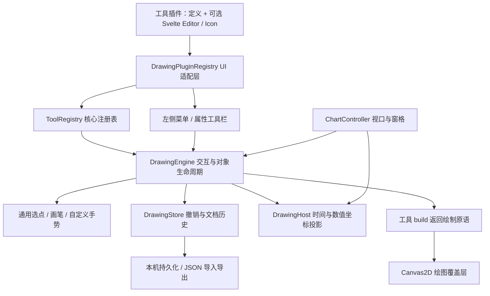

# 可扩展绘图工具架构

> 2026-09-05 更新：已新增统一图层、右侧对象树、多选分组和多周期指标。保存格式升级为 v2；本文件描述原绘图插件契约，工作区行为以 [图层工作区](layer-workspace.md) 为准。

## 目标与边界

左栏的分组顺序、窄图标栏、展开菜单及磁吸/连续绘制/锁定/隐藏等通用操作参考 TradingView 的实际 Supercharts 页面和官方工具说明。本项目自行实现工具、图标、对象与渲染，不引入 TradingView SDK。

当前有 24 个工具入口：23 个内置入口（含游标、橡皮擦和临时区域缩放），以及一个自定义价格区域示例。并非 TradingView 全量工具集；江恩、复杂谐波/波浪分析、成交量分布等未实现，也没有不可用的占位按钮。仓位工具为图上目标/止损/盈亏比标注，不会提交交易。

参考：[工具分类](https://www.tradingview.com/support/solutions/43000703396-drawing-tools-available-on-tradingview/)、[左栏操作](https://www.tradingview.com/support/solutions/43000746464-getting-started-with-supercharts/)。

## 分层



- `src/lib/drawing/`：框架无关的工具契约、注册表、手势、历史、几何与引擎。**不依赖 Svelte。** 对外统一从 `index.ts` 导出。
- `src/components/drawing/`：侧栏、分组菜单、对象列表、通用属性工具栏、图标及 Svelte 插件适配层。
- `src/plugins/drawing-tools.ts`：应用的组合入口；注册工具和可选专属组件。
- `src/plugins/price-zone/`：已经接入并验证的自定义例子，可直接参考其文件拆分。
- `ChartController`：只负责把鼠标、键盘、时间/价格映射交给引擎，保持价格轴/分隔线操作优先；没有按工具 ID 分支。

绘图放在独立的 Canvas2D 覆盖层。K 线和指标仍走原有 WebGL 管线；编辑绘图只使覆盖层失效，不重新计算百万根数据或指标。

## 工具定义

核心 `DrawingTool` 包含：

| 字段 | 职责 |
| --- | --- |
| `id / name / group / icon / order / shortcut` | 标识、分类、图标与入口 |
| `points / freehand` | 复用通用选点或自由画笔手势 |
| `createGesture()` | 可选的自定义放置交互，替换默认手势 |
| `fields / defaultStyle / supportsFill` | 默认属性、通用编辑控件和填充能力 |
| `build(drawing, projection)` | 纯渲染描述：path / rect / ellipse / text |
| `handles(drawing)` | 可编辑控制点的下标；默认所有点，画笔不显示密集控制点 |
| `hitTest(pixel, drawing, projection)` | 可选的自定义选中测试；默认按绘制原语选中 |
| `onComplete(drawing, services)` | 放置完成回调；普通对象返回 store，区域缩放等临时工具可执行命令并返回 discard |

`ToolGesture.pointer(phase, input)` 接收 down/move/up，返回数据坐标数组及 `complete`。默认两点工具支持点击两点和直接拖动；三点/四点工具分次选点。自由画笔按距离采样并限制为 2,048 点。

工具的 build 和 hitTest 应保持纯函数，不修改 Drawing，不读写全局图表状态。扩展组件是项目内受信任的代码，不是执行陌生脚本的沙箱。

## 新增一个工具

1. 在 `src/plugins/<tool-name>/definition.ts` 实现 `DrawingTool`。
2. 在 `src/plugins/drawing-tools.ts` 中注册；侧栏、对象选择、控制点、整体移动、锁定、隐藏、撤销、保存自动复用。
3. 如果 `fields` 不够表达属性面板，再添加可选的 Svelte `Editor`；也可以提供专属 `Icon`。

实际已注册的示例：

```ts
import { drawingPlugins } from './drawing-tools';
import { priceZoneTool } from './price-zone/definition';
import PriceZoneEditor from './price-zone/PriceZoneEditor.svelte';

// 这是现有组合入口使用的注册方式，不要重复注册相同 ID。
drawingPlugins.register({
  definition: priceZoneTool,
  Editor: PriceZoneEditor,
});
```

自定义编辑组件契约：

```ts
interface ToolEditorProps {
  drawing: Drawing;
  update: (props: DrawingProps) => void;
  disabled?: boolean;
}
```

组件调用 `update({ label: '支撑区' })` 即进入引擎的统一变更/历史/持久化路径。不要从编辑组件直接改绘图数组或调用 Canvas。

### 标签字号与可读性

`DrawingStyle.fontSize` 是可选的通用字号，默认 13、可调范围 12–32 CSS 像素。它独立于价格/时间坐标缩放；Canvas 使用图表已有的 DPR 变换，不再次放大字号或缩放文字位图。旧 v1/v2 绘图可继续没有此字段，旧文字工具的 `props.fontSize` 仍作为兼容值；明确设置通用字号后优先使用新值。属性窗口预览、取消、确认及撤销和其他样式一样工作。

带文字的自定义工具可声明 `supportsLabels: true`，在 `build()` 内使用 `drawingFontSize(drawing)`（来自 `lib/drawing/labels.ts`）填入文字图元的 `size`。共享渲染器也会应用通用字号，因此旧插件中的硬编码字号不会阻止用户调整。示例 `price-zone` 已采用此接口。`maxWidth` 可选，用于屏幕宽度不足时省略尾部文字；完整标签内容及锚点不被修改。

同一绘图先画几何、后画标签，避免后续 Fib 水平线穿过已画文字。标签背景按 Canvas 实测字宽/字高生成；文字颜色保留原色相并提升到对深色底至少 4.5:1 的对比度。默认命中检测复用渲染时的文字框，字号和对齐变化后仍能选中标签。

静态网格和最新价虚线通过 `plotGuideSegments()` 进入场景底层；上方轴画布以 `plotGuides: false` 只画轴文字、价签和窗格边界。这样辅助线也不会穿过标签，且保持 GPU 直出与现有图层排序。

Fib 标签在窗格内按字号纵向避让，移位时绘制对应水平的连接线。窗格无法容纳全部标签时优先显示端点和关键比例标签，所有水平线仍保留在原始价格坐标；跨绘图的遮挡继续遵循对象树层级。

新增分类时注册 `group: { id, name, order }`。`DrawingPluginRegistry.register()` 返回注销函数；重复 ID 或未知分类会报错，不会静默覆盖已有工具。

## 数据与历史

`Drawing` 保存纯 JSON：id、toolId、paneId、`{ time, value }[]`、style、props、locked、hidden。时间为毫秒时间戳，value 在主图表示价格，在副图表示对应指标值。对象不保存 CSS 像素位置。

`DrawingHost` 提供投影和逆投影；时间查找使用二分搜索，支持不连续交易时间及已加载区间之外的锚点。缩放、平移、改变窗格高度、最大化或 DPI 改变时，工具沿用相同数据锚点重新投影。被关闭的指标窗格中的对象保留，重新开启后恢复显示。

一次放置、一次控制点拖动、一次整体拖动、一次属性修改各为一个历史动作。移动过程只更新编辑预览，松开才提交，Esc/取消不污染历史。每个市场保留最多 80 步历史；新操作清除 redo 分支。

持久化键为 `tvchart.drawings.v1:<source>:<symbol>`：模拟与 Binance 隔离，不同交易对隔离，同一交易对跨周期共享时间锚点。刷新后恢复已提交对象；尚未完成的预览不会保存。浏览器历史不跨刷新恢复。

JSON 文档包含 `version: 1 / market / drawings`。导入先整体验证再替换，检查有限坐标、样式、重复 ID 和大小限制；属于其他市场的文档不会导入当前市场。未知工具对象保留，安装对应工具定义后可以恢复显示。图层隐藏/锁定等全局工作模式为当前会话状态。

## 交互约定

- 趋势/形状边缘或控制点可选中；拖控制点编辑，拖线段/形状边缘整体移动。
- 所有工具可画在主图和已有指标窗格中；一次放置始终属于起始窗格。
- 右侧价格刻度和窗格分隔线优先处理，绘图工具不夺走其缩放/调高行为。
- 磁吸在主图靠近 K 线 OHLC 时生效；其他位置仍使用自由坐标。
- 连续绘制保持当前工具；普通模式完成后回到选择工具。
- Delete / Backspace 删除选中对象；Ctrl/⌘ Z 撤销，Shift Z 或 Ctrl/⌘ Y 重做；Esc 取消当前绘制/选中。
- Alt T / H / V 对应趋势线、水平线和垂直线。
- 工具栏属性输入框保持原生键盘行为，不把文本编辑的 Delete/撤销误发给图表。
- 清除未锁定绘图可撤销；全局/单对象锁定阻止移动或删除。

未来可加批量选择、图层排序、收藏栏、更多复杂工具或远端保存；这些扩展沿用注册表、文档和命令路径，不需要改变行情和指标计算链路。
