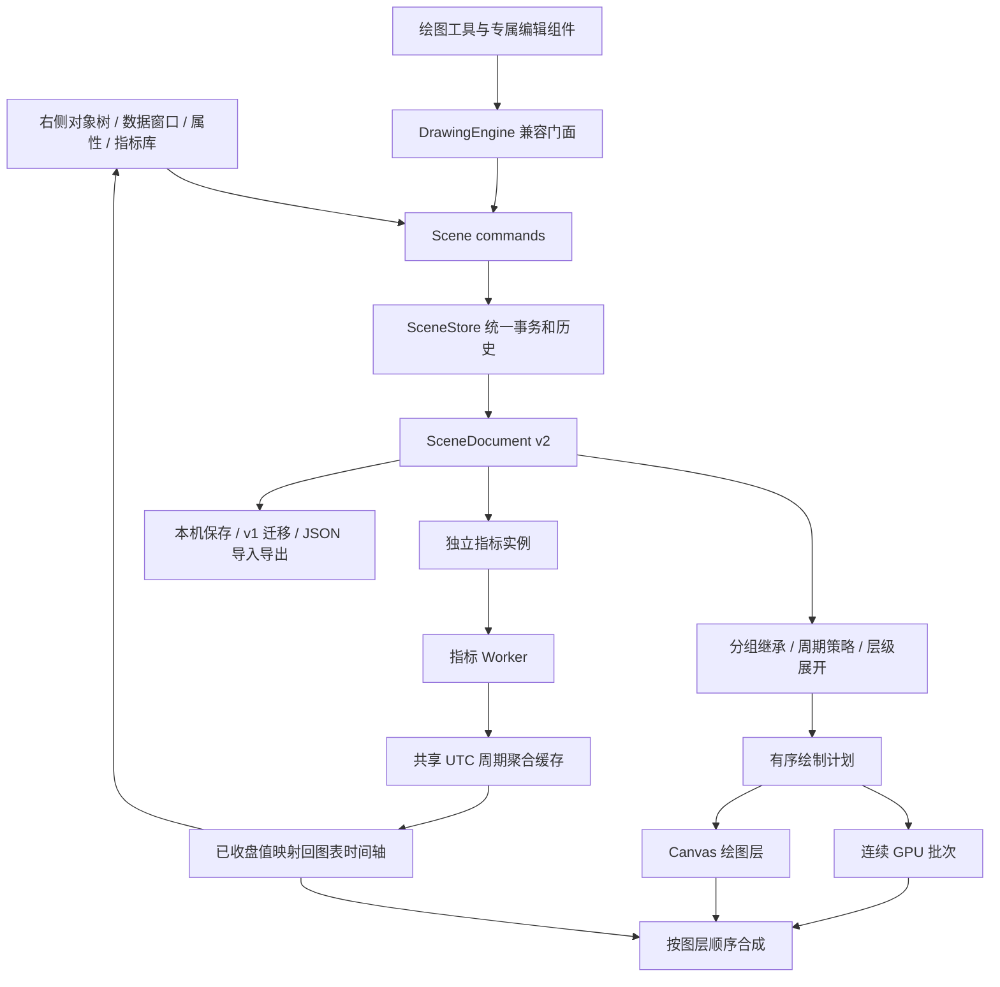

# 统一图层工作区 · 2026-09-05

## 已落实的模型

行情序列、指标实例、绘图、外部叠加和图层组共用 `SceneDocument`。右侧对象树、真实绘制顺序、选中测试、可见性、锁定、历史记录和持久化都读取这份文档。

这几个维度彼此独立：

| 维度 | 含义 | 例子 |
| --- | --- | --- |
| 窗格 `paneId` | 所属绘制区域和数值坐标系 | 主图、成交量、MACD、独立 RSI |
| 分组 `parentId` | 对象组织和继承状态 | 小时级分析组包含小时 MA 与趋势线 |
| 层级 | 同级列表顺序及分组的整体位置 | 矩形置于 K 线后方，Fib 放到指标前方 |
| 显示周期 `intervals` | 在哪些图表周期显示 | 仅在 1h、4h 显示一组分析 |
| 计算周期 `timeframe` | 指标实际使用的数据周期 | 1m 图上计算 1h MA(50) |
| 创建周期 `createdInterval` | 记录创建上下文，支持筛选 | 在 1m 图上创建的绘图 |
| 元素类型 `kind` | 行情、指标、绘图、分组、外部数据 | 可按类型单独查看 |

**显示周期不等于计算周期。** 一个按 1h 计算的 MA 可以只在 1m 和 5m 图上显示；其原始计算周期仍然是 1h。不同指标实例有独立 ID、参数、源周期和序列显示开关。

## 模块职责



- `src/lib/scene/types.ts`：工作区、图层、指标实例和周期类型。
- `src/lib/scene/model.ts`：层级展开、状态继承、结构验证。
- `src/lib/scene/commands.ts`：分组、移动、排序、解散、批量删除。
- `src/lib/scene/store.ts`：绘图、指标、分组共用一份 undo/redo 历史。
- `src/lib/scene/serialization.ts`：v1 绘图升级、v2 完整文档导入。
- `src/lib/indicators/timeframe.ts`：UTC OHLCV 聚合及增量更新。
- `src/lib/indicators/runtime.ts`：多实例计算、高周期映射。
- `src/lib/render/backend.ts`：跨 WebGL 和 Canvas 的有序合成。
- `src/components/workspace/`：右侧视图与通用属性编辑。

`DrawingStore` 名称保留为 `SceneStore` 的兼容导出；新代码可以直接从 `src/lib/scene/index.ts` 使用 Scene API。原绘图插件仍只需注册定义和可选 Svelte Editor/Icon，工作区会自动为其创建图层元数据。

## 层级不是列表装饰

对象树从前到后显示，绘制计划从后到前执行。分组展开后是连续的绘制块。组内上移只影响同组对象，移动整个组会整体改变其子对象与其他元素的遮挡关系。

渲染后端将相邻 GPU 图层合并绘制，在遇到 Canvas 绘图层时合成当前 GPU 批次，再继续下一段。由此可交错安排：绘图 → K 线 → 指标 → 绘图，而不是固定让所有绘图盖在最上面。选择控制点与未完成的交互预览始终在最上层，已提交的图形遵循文档顺序。

实际像素测试：同一采样点，矩形置顶为蓝色 `[0,0,255,255]`；移至 K 线后方后变为下跌蜡烛色 `[239,83,80,255]`。命中测试使用相同的绘图顺序，确保重叠对象优先选中前层。

## 分组和选择规则

- 多选：Ctrl/⌘ 点选切换，Shift 连续选择；树内 Ctrl/⌘ A 选择当前分类结果。
- 分组可包含同一窗格中的指标、绘图、行情与外部叠加，也支持嵌套组。
- 同组对象必须属于同一窗格，防止价格与 RSI 等不同数值坐标系在移动时被隐式混合。
- 子对象继承父组的隐藏、锁定、透明度和显示周期交集。
- 解散组时保留组产生的可见性、透明度和锁定效果，避免解组后图形突然改变。
- 分组树不可形成循环；跨窗格拖入会明确拒绝。
- “新绘图加入”可以选定目标组。目标组被锁定、隐藏、不适用于当前周期或属于其他窗格时，不会悄悄创建不可见对象。
- 拖入组的中部进行归组；拖到对象上/下半区改变层级；工具栏也提供上移、下移、置顶、置底、移出组等操作。
- 批量隐藏、显示、锁定、解锁、复制和删除进入统一历史。锁定的对象或含锁定子对象的组不会被删除。

对象树支持按窗格/分组、元素类型或来源周期查看，并可筛选当前可见/隐藏状态。列表按可见区域渲染，已测试 1,008 个节点时仅创建 13 个可见树行。

## 多周期计算的准确性

- “跟随图表”：按主图原始数据计算，包含正在更新的末根 K 线。
- 明确选择固定周期（如 1h）：输出上一根已收盘的该周期值。即使主图后来切换到同一周期，仍保持已收盘语义。
- 更高周期使用 UTC 时间桶聚合 OHLCV；同一源周期的多个实例共享聚合缓存。
- 初始历史从周期中部开始时，丢弃第一个不完整桶，不把残缺数据当完整高周期 K 线。
- 不将尚未完成的高周期最终值回填到较早的小周期 K 线上，避免未来数据泄漏和实时重绘。
- 末根替换会重算受影响桶的 high/low/volume，避免重复累加。
- 固定周期低于主图周期时，当前实现没有足够数据重建它，保留对象并显示“需要更低周期数据”；不会用大周期价格伪造小周期结果。
- Binance 当前初始历史仍为最近 1,000 根；高周期指标可能历史不足，数据窗口会显示预热/历史不足，而不是给出假数值。
- 参数快速修改时，旧 Worker 配置结果会被丢弃，直到最新配置返回才结束“正在计算”状态。

当前集中支持 1m / 5m / 15m / 1h / 4h / 1d。模拟行情按所选基础周期生成，用于性能演示；真实 Binance 同周期数据及高周期聚合遵循该基础历史。独立低周期源、跨图表联动和服务端历史补齐是进一步的数据源工作，不在此轮中冒充完成。

## 外部组件与数据层接入

```ts
// 普通指标实例：重复调用会创建独立实例。
controller.addIndicator('ma', '1h');
const instanceId = controller.drawing.state.scene.selectedIds[0];

// 图层设置与计算参数分开。
controller.setParam(instanceId, 'period', 50);
controller.drawing.updateLayers([instanceId], {
  intervals: ['1m', '5m', '1h'],
  opacity: 0.8,
});
controller.drawing.reorderLayers([instanceId], 'front');

// 外部策略/自定义数据仍走声明式叠加，稳定 ID 保持层设置。
controller.setOverlays([{
  id: 'strategy:signal',
  name: '策略信号',
  pane: 'main',
  paneId: 'main',
  timeframe: '1h',
  kind: 'line',
  values: alignedValues, // 外部提供、与当前图表索引对齐的 Float64Array
  color: '#78aaff',
}]);
```

外部数据载荷不写进工作区 JSON，只保存其图层元数据。刷新后在数据源重新供给前显示“等待外部数据源”。外部层参与窗格自动数值范围，也会出现在对象树和数据窗口。

## 保存与迁移

- v2 保存绘图、图层、分组和指标配置，按 `source:symbol` 隔离。
- 键名：`tvchart.workspace.v2:<source>:<symbol>`。
- 自动读取旧 `tvchart.drawings.v1:*`，保留原绘图锚点，补入默认行情/指标图层。旧记录不删除。
- 导入先验证完整结构、父子引用、唯一 ID、周期、透明度和指标参数；失败不覆盖当前工作区。
- 文档损坏时加载默认图表并提示，原存储记录保留。
- 图表当前视口、窗口尺寸、展开状态和本次多选为界面状态，不混入历史数据载荷。
- 误删主行情序列可撤销，也可从指标库恢复 K 线或成交量柱。

## 本轮范围

已实现单图表、多窗格、多图层、多指标实例及高周期叠加。没有新增并排多图、账户交易、低周期独立抓取、云端协作或完整 TradingView 工具全集。

参考：[TradingView 对象树与分组](https://www.tradingview.com/blog/en/new-object-tree-15090/)、[真实视觉顺序](https://www.tradingview.com/support/solutions/43000474299-how-can-i-change-the-visual-order-layer-of-indicators-drawings-candles/)、[按周期显示](https://www.tradingview.com/support/solutions/43000484410-how-to-set-drawing-visibility-on-different-intervals/)、[数据窗口](https://www.tradingview.com/blog/en/floating-data-window-under-your-cursor-52715/)。

## 属性弹窗与选择呈现

对象树选择与属性编辑分开。单击只选中；双击或显式设置操作打开统一 ObjectPropertiesDialog。图表选择事件带局部坐标，用于定位简洁快捷条，其设置操作仍进入同一 dialog。ToolPlugin.Editor 现在位于弹窗样式页。SceneStore 的 beginPreview / finishPreview 提供即时预览，取消不影响历史或持久化，确定把整次编辑提交为一步 undo。编辑会话绑定市场和目标 ID，避免误写其他对象。
